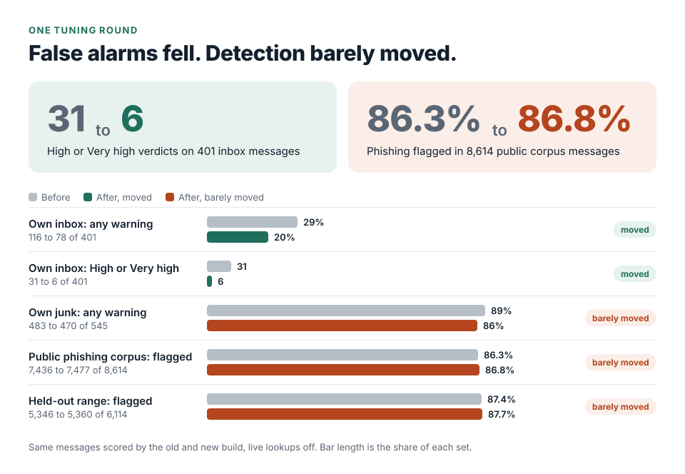

# Cutting false alarms in a phishing analyser, and what the numbers did not show

Jatzo reads an email and returns a 0 to 100 risk score with the evidence behind it. This is the account of one
tuning round, engine version 11.25, finished before 10 September 2026: what I measured, what was wrong, what
changed, and the part that did not improve. A shorter round on 12 September 2026 is at the end.

The short version. High or Very high verdicts on my own real inbox fell from 31 to 6, and no legitimate message
got worse. Detection of phishing on a large public corpus stayed essentially flat, on the held-out range as well as
the whole. Most of this piece is about the second sentence.

## What the words mean here

Every message lands in one of four bands: Low, Suspicious, High or Very high. A "warning" or "flagged" means
Suspicious or above. "Not analysed" means the engine gave no score at all.

## The question

Two problems, one engine. It was missing some phishing, and it was warning about ordinary mail. Before changing
any rule I wanted to know why, answered against real messages. The build began as a diagnostic pass, and my
evaluation report records that no rule was changed until that diagnosis was done.

## How I measured

Two sets of mail, scored as pairs: the old build and the new build on identical bytes, with live lookups switched
off so nothing outside the code could vary between runs.

| Set | What it is | Where it ran |
| --- | --- | --- |
| 8,614 phishing-labelled messages | A public honeypot collection, real messages with full headers, 2022 to 2025 | A disposable cloud container with no access to my machine |
| 401 inbox and 545 junk messages | My own mailbox, 2018 to 2026 | My own machine. The messages never left it |

Three decisions made the result more believable.

**A held-out range, fixed before any rule was written.** I sorted the public collection by filename and used the
first 2,500 messages to diagnose problems. The other 6,114 were not examined during development. The collection
numbers samples in the order they were submitted, so the split is also roughly chronological. The held-out range
tests whether a fix generalises to later campaigns.

**Folder placement is provenance, not truth.** My inbox is not guaranteed safe and my junk folder is not guaranteed
malicious. Both contain mistakes in both directions, and so does the honeypot: it collects newsletter
subscriptions, so some of the "phishing" the engine scored Low was ordinary marketing that it classified
correctly. Every figure below is bounded by that.

**Nothing from the samples went into the product.** No sender, domain or hash from any message was added to a rule
or a list.

The design gives me no held-out set of legitimate mail. I examined the inbox's false alarms by
hand, fixed their causes, and then measured on the same 401 messages. So 31 to 6 shows that the faults I found are
fixed. It does not show how the engine would do on somebody else's inbox.

## What was wrong

Of the 2,500 development messages, 410 (16.4%) scored Low or were not analysed at all. Three causes stand out.

**Refusing to analyse was the failure mode.** Some malformed input made the parser raise, and the message was
rejected rather than scored. That is the most attacker-friendly outcome available, because it lets a sender choose
to be skipped. Twenty-two messages were not analysed at all, from a parser failure or a size limit, and 12 of the
13 that could be recovered scored High or Very high once the engine degraded instead of refusing.

**One number answered two questions.** "Is this trying to steal my credentials or money?" and "is this unsolicited
junk?" were being added into the same total. A gambling promotion and a credential-harvesting page could reach the
same band on completely different evidence. The two kinds of evidence are now separate, so unwanted mail is still
surfaced but cannot on its own claim a phishing verdict.

**A check that switched itself off.** One impersonation check had been written with a sensible exclusion, so that
people writing under their own name were not accused. Combined with a second condition, it removed the check from
a place where a large class of fraud lives: 99 of the 388 missed messages, 26%, were sent from consumer mailboxes
with a display name presenting an institution.

One finding surprised me. 375 of the 388 phishing messages the engine missed reported a passing sender check.
Modern phishing is sent from domains the attacker owns, and those authenticate correctly. Authentication shows a
domain authorised a message, and nothing about whether the message is honest. The engine's weighting still leaned
on it as though it were a trust signal.

## Results

Paired, identical bytes, live lookups off.

| Set | Before | After |
| --- | ---: | ---: |
| My inbox, any warning | 116 (29%) | 78 (20%) |
| My inbox, High or Very high | 31 | 6 |
| My junk, any warning | 483 (89%) | 470 (86%) |
| Public phishing corpus, flagged | 86.3% | 86.8% |
| Public phishing corpus, not analysed at all | 76 | 35 |
| Held-out range only, flagged | 5,346 (87.4%) | 5,360 (87.7%) |
| Held-out range only, not analysed at all | 54 | 25 |

The full band counts are below, so each column can be added up.

Band counts for every set

Public phishing corpus, all 8,614 messages:

| Band | Before | After |
| --- | ---: | ---: |
| Low | 1,102 | 1,102 |
| Suspicious | 2,008 | 2,509 |
| High | 2,736 | 2,534 |
| Very high | 2,692 | 2,434 |
| Not analysed | 76 | 35 |
| Flagged | 7,436 | 7,477 |

Held-out range, 6,114 messages:

| Band | Before | After |
| --- | ---: | ---: |
| Low | 714 | 729 |
| Suspicious | 1,605 | 2,039 |
| High | 2,079 | 1,901 |
| Very high | 1,662 | 1,420 |
| Not analysed | 54 | 25 |
| Flagged | 5,346 | 5,360 |

My inbox, 401 messages:

| Band | Before | After |
| --- | ---: | ---: |
| Low | 282 | 320 |
| Suspicious | 85 | 72 |
| High | 23 | 4 |
| Very high | 8 | 2 |

My junk, 545 messages:

| Band | Before | After |
| --- | ---: | ---: |
| Low | 62 | 75 |
| Suspicious | 48 | 74 |
| High | 104 | 121 |
| Very high | 331 | 275 |

"Any warning on my inbox" is not a false-alarm rate. The inbox holds some phishing, which is why it is the right
place to look for messages that should move up as well as down.

I examined all 31 of the original High and Very high inbox verdicts by hand. Essentially all were false alarms; the
report gives no exact count. They came from a small number of identifiable mechanisms, the largest being a brand
check run against an incomplete catalogue of each brand's real domains. Those were faults in the engine. The report
does not break down the 6 that remain, so I make no claim about them.

Only three inbox messages moved up a band after the change. All three were checked by hand, and all three were
phishing: a government e-ticket lure sent from a consumer mailbox, a fake statement update and a fake sign-in alert.
No junk message moved up. 85 moved down, mostly from Very high to High or Suspicious, because their evidence had
been spam classification rather than attack behaviour.

## The honest reading

This was a calibration result. Detection barely moved. Across the corpus, 105 messages became flagged and 105
stopped being flagged. The net gain of 41 came almost entirely from messages the old build could not analyse at all.

538 phishing-labelled messages dropped from High or Very high to Suspicious. For 433 of them, the old verdict
rested partly on a rule matching text it should never have matched. The other 105 dropped because their evidence
was spam classification rather than attack behaviour. That is a real reduction in stated confidence.

Separately, 105 messages stopped being flagged at all. Those are genuine detection losses on a labelled corpus, even
though each came from a correction working as designed.

## What was still wrong at the end of the round

My report for this round says in its first lines that it is not a production-readiness statement, and that the
weaknesses left are substantial. The ones I can describe in public:

- 197 of the 410 missed development messages sat just below the warning threshold. Lowering the threshold is the
  wrong fix, because it would move legitimate mail across at the same rate.
- Content rules still read marketing footers and unsubscribe text as though the sender had written them, and
  several of the remaining false alarms trace to that.
- A genuine cryptocurrency promotion still scored Very high.
- 239 of the 388 missed messages were classified as having an "unclear" intent, so intent was not helping where it
  was most needed.
- Neither set has independent labels, so every figure here is bounded by how the mail was labelled.

## A later round, and what I did not ship

A later round, on 12 September 2026, used 170 of my business messages, which I treated as safe. 14.1% were flagged
on the website path (a message uploaded to the website, where no delivery header is trusted), and half of the 24
flagged were one-time codes, sign-in codes and verify-your-email messages. Two rules were firing on that safe mail
and never on junk. I narrowed one, which took three business messages out of the warning band, and renamed the
other without changing its score. Flagged business mail fell from 24 messages to 21, and no junk message changed
score. On the add-in path, which reads the mailbox the way an installed add-in would, flagged business mail fell
from 19 to 17.

Three further candidate changes also showed "zero junk messages changed". I shipped none of them. One would have
weakened a pattern that also covers a real attack, and my junk folder held no example of that attack, so "nothing
changed" only showed that my test set was silent on the question. One helped a single message, and a link to a
social network can host a trap. One would have softened trusted mail from well-known brands, and genuine platforms
are abused for fraud from their own addresses.

I stopped there. The remaining false alarms were wording shared with real phishing, such as urgency and credential
language, and retuning those on 170 messages from one mailbox would have fitted the engine to my senders. That
needs a second, larger set of legitimate mail, so the next step went into the notes instead.

This is also the run in which a safety stop fired and needed me to clear it by hand. That is the subject of the
[postmortem](04-postmortem-late-container-removal.md).

## What I would do differently

- Keep a permanent paired evaluation harness in the repository, so every future change reports both numbers by
  default. My report lists this as a recommendation.
- Get consented, independently labelled legitimate business mail. Every accuracy claim here is limited by how the
  mail was labelled.

## Checks

500 automated tests passed in the cloud container, 64 of them new. 14 others failed there, and they failed the same
way on the unmodified build, in an environment that lacked PDF generation, live providers and a QR library. The
report says the definitive run belongs on my own machine, and the real container checks could not be run in the
cloud one. The records I hold do not show that definitive run for this build, so I do not claim it. Each of the
false-match defects the report lists has a test showing the false match no longer fires and a test showing the real
thing still does.

## Evidence

The engine and its reports are private. Here is what each claim rests on.

| Claim | Source | What is shown here |
| --- | --- | --- |
| Method, band counts, causes, hand review, tests | My evaluation report for engine 11.25 | Every figure, and the band tables in full. Sender domains, rule patterns and scores are left out, so the post cannot be used to tune mail past the engine |
| The later round and the three changes not shipped | My evaluation report for 12 September 2026 | Every figure. Message subjects and senders are left out |
| The public corpus | A public honeypot collection of phishing-labelled messages, 2022 to 2025 | Counts only. No message from it is quoted |
