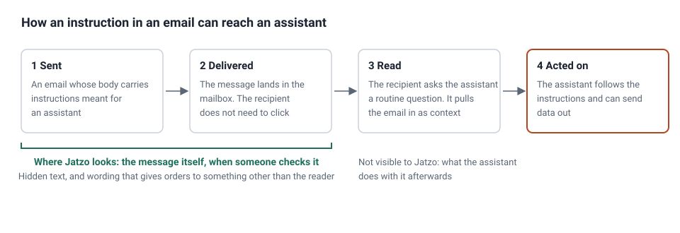
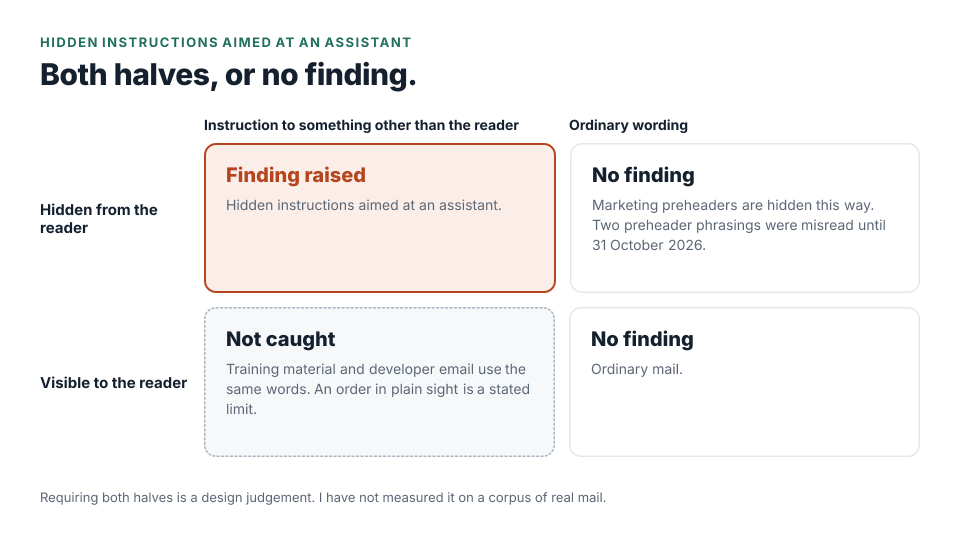

# Spotting prompt injection hidden in an email

Email assistants can read a mailbox on a person's behalf. That makes every message a place where somebody else's
words get read by something that can act. This is the account of how I decided what a phishing analyser should do
about it, what I built in September 2026, what I got wrong, and where it stops.

## The attack, in one example

[CVE-2025-32711](https://msrc.microsoft.com/update-guide/vulnerability/CVE-2025-32711), published on 11 June 2025
and named EchoLeak, was a flaw in Microsoft 365 Copilot, scored 9.3 under CVSS 3.1 by Microsoft. Trend Micro's
write-up credits researchers at Aim Security with the attack. An attacker sent an email whose body carried
instructions meant for the assistant. Later, when the recipient asked the assistant something routine, the
assistant acted on those instructions, gathered data the person could reach and sent it out. It needed no click on
the message.
[Trend Micro's write-up](https://www.trendmicro.com/en_us/research/25/g/preventing-zero-click-ai-threats-insights-from-echoleak.html)
reports that Microsoft fixed it on its own servers, with no customer action needed, and that there were no known
real-world incidents.

For a phishing analyser, the useful fact is where the attack starts: the body of an ordinary message, delivered with
no click. The threat framework this work draws on, MITRE ATLAS, names email as a channel for this kind of injection
([AML.T0051.001, Indirect](https://atlas.mitre.org/techniques/AML.T0051.001)) and invisible text as a usual hiding
place ([AML.T0068, LLM Prompt Obfuscation](https://atlas.mitre.org/techniques/AML.T0068)). Hidden text is a general
technique and is not claimed here as EchoLeak's own method. It is also material Jatzo already extracts.

## What I already had, and what was missing

Jatzo already found hidden text: text styled so it never appears on screen. Its checks answered one question,
whether text was hidden. None of them looked at what the hidden text said, so a message with three hidden words
and a message with hidden orders to an assistant scored the same. My own gap review of the engine against published
threat research found that. It was a hole in my own coverage.

## The design decision

The rule requires two things together: text that is concealed from the reader, and wording that gives an
instruction to something other than the reader. Either half alone is common in honest mail.

- Wording alone would match security training material, a developer emailing prompt text to a colleague, and a
  vendor quoting a jailbreak in a newsletter.
- Hiding alone is ordinary in marketing, where preview text is often hidden.

Requiring both should remove almost all of those false alarms, because none of those honest examples hides its
words. That is a design judgement. I have not measured it on a corpus of real mail. The finding is also worded with
care. Jatzo cannot know whether a recipient has an assistant reading their mailbox, so the finding describes a
risk, not an event, and says so to the customer.

I also decided not to keep a list of assistant products or their addresses. A list of this year's assistants goes
stale. The wording of an instruction is the part that does not date.

## Proving it, including what must not fire

The first tests followed the same shape as the design:

- One message built to carry the attack, which must be caught.
- Three genuine messages, of the kinds above, which must not be.
- A test showing that the new rule is not doing work an existing rule already does. If that ever stops being true,
  the test fails and says so.

That is four hand-built messages, not a measurement. The wider check I have is the engine's own set of 549 scoring
test messages: the 3,955 pieces of unseen text in 415 of them match nothing. Those messages were not collected to
test this rule, so that is evidence of no obvious false alarms, and it is not a false-alarm rate.

## What I got wrong

**The first version read the message body and nothing else.** A later review showed the same instructions can travel
in other places: inside an attachment, in a link's own address, and in parts of the page a reader never looks at
but an assistant given the page's code does, such as image descriptions and comments. Those became separate checks
that share one definition of what an instruction looks like, so the wording does not drift between them. The link
case came from reading a separate entry in the same framework,
[AML.T0131, Crafted AI Assistant Links](https://atlas.mitre.org/techniques/AML.T0131), which describes a way of
carrying the payload that nothing in the engine inspected.

**The design judgement was not fully right.** On 31 October 2026 I found two ordinary preheader phrasings that, when
hidden, read as orders: one telling the reader to use an app to reply, and one telling them not to share a code.
Each cost a full finding. The scoring test set held neither phrasing, which is why it had not caught them. I
tightened the wording the rule needs, and every tested instruction still fires.

## Where it stops

The limits are in the rule's own notes, along with why I chose not to widen it:

- **It assumes the instruction is hidden.** An instruction in plain sight, in small grey text that is technically
  visible, is not caught. Catching it would mean letting the wording carry a finding on its own, which brings back
  false alarms on training material and developer email, because they contain the same words.
- **It catches common phrasings, in English.** An attacker who rewords or encodes the order, or puts it in an
  image, gets past it.
- **It cannot see the assistant.** Jatzo does not know whether one is reading the mailbox, or what it does next.

## When Jatzo sees the message

Jatzo is not in the delivery path. It checks a message when a person pastes it or opens it in an add-in, and an
assistant may already have read it by then. The rule describes what to be wary of, and tells the customer not to let
an assistant act on the message and to report it to whoever runs their mail.

## Mapping

MITRE ATLAS AML.T0051.001 and AML.T0068 for the attack and its hiding, and AML.T0131 for the link case. MITRE
ATT&CK added [T1698, Indirect Prompt Injection](https://attack.mitre.org/techniques/T1698/) in its October 2026
release, and the three rules now carry it.

## Evidence

The engine and its notes are private. Here is what each claim rests on.

| Claim | Source | What is shown here |
| --- | --- | --- |
| The CVE, its date and score | The [CVE-2025-32711 advisory](https://msrc.microsoft.com/update-guide/vulnerability/CVE-2025-32711) | Linked |
| Credit, the server-side fix, no known incidents | [Trend Micro's EchoLeak write-up](https://www.trendmicro.com/en_us/research/25/g/preventing-zero-click-ai-threats-insights-from-echoleak.html) | Linked |
| The framework entries | MITRE ATLAS and ATT&CK, linked above | Linked |
| The gap, the design and the decision | My gap review and threat research log, September 2026 | Described. The wording lists and thresholds are left out, so the post cannot be used to write around the rule |
| The tests, the fixture check and the preheader fix | The rule's own documentation and the commit history | Described |
