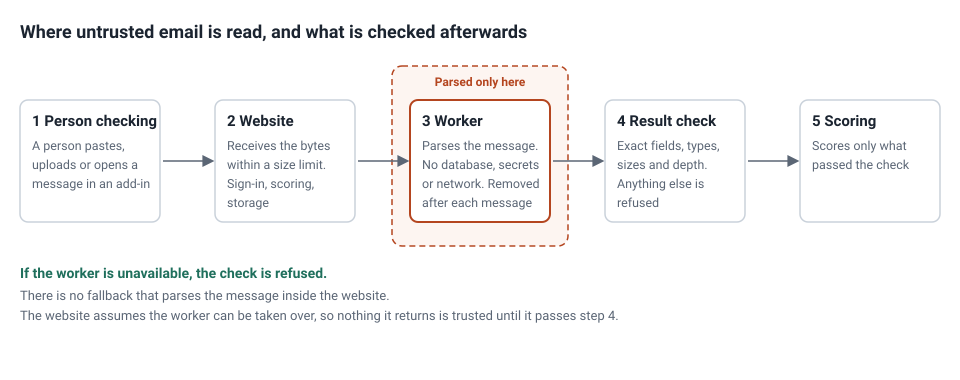
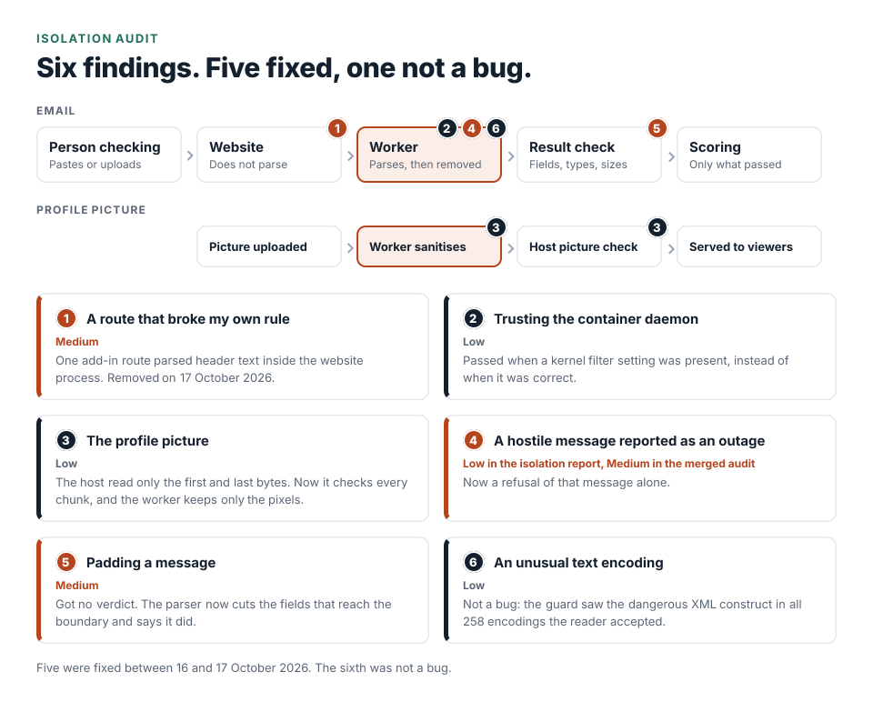

# Reading hostile email safely, and what a security audit found in my own sandbox

A phishing analyser has an awkward job. To judge an email it has to open it: read the headers, the HTML, the
attachments, the Office documents, the PDFs. Every one of those parsers is code that somebody else's bytes can try
to break. If that code runs in the same process as the website, a flaw in a parser lands in the process that holds
sessions, the database and the signing keys.

This is how Jatzo handles that, and what an audit of the design found. The audit was an internal, static review of
the isolation code, dated 11 October 2026. Nobody outside reviewed it, and it ran no tests: it read the code and
built and ran nothing. It reported no critical or high findings, three medium and ten low. I describe six of them
here, each with its severity. Five were fixed in the code between 16 and 17 October 2026 and are covered by tests.
The sixth was not a bug. I have left the others out of a public post while the product is live.

## The design

An uploaded message does not get parsed by the website. It goes to a disposable worker, a restricted Linux
container that is started for the message and thrown away afterwards. The worker has no access to the database, the
secrets or the network. It returns a bounded JSON result, and the website checks that result before anything
uses it.

Three rules shaped everything else.

**Assume the worker can be taken over.** A container reduces exposure. It is not a guarantee against a flaw in the
container runtime or the kernel underneath. So the website never trusts what the worker sends back. It checks the
exact set of fields, their types, their sizes and how deeply they nest, and it only ever decodes JSON.

**Fail closed.** If the isolation is unavailable, the check is refused. There is no fallback that parses the message
in the website process, because a fallback is the exact path an attacker would look for.

**Be honest about what isolation is not.** It does not certify that a document is safe to open, and it is not malware
detonation. A low score is not permission to open a file. The documentation says so.

## Six things the audit found

### 1. A route that broke my own rule (Medium)

The worst finding was a direct contradiction of the design above. One add-in route took a block of header text
from the request and parsed it inside the website process, with no container. The text was written by whoever sent
the mail, so a fault in the standard header parser would have landed in the process that holds sessions and keys.
It was a separate feature that had never been routed through the worker.

I removed the feature rather than routing it through the worker. It let the engine learn a sender's history from
messages a person had only opened, and learning now comes from checks alone. The boundary claim above is true from
17 October 2026. Before that date it was not.

### 2. A check that passed when a setting was present, instead of when it was correct (Low)

Before trusting the container daemon, the broker asked whether a certain kernel filter appeared in the daemon's
security options. A daemon with that filter switched off still lists it, with the profile marked unconfined. A
maintenance change that turned the filter off would have been believed, and containers would have run without it.
The check now reads the entry itself and refuses the unconfined case. A safety check should test the property
itself.

What it still accepts: a custom filter profile named by a file. A permissive custom profile would pass this check.
The worker's own check of the filter, made from inside the container, is unchanged.

### 3. A host check that read the first and last bytes only (Low)

The worker produces a sanitised profile picture, and the website accepted whatever came back if it was the right
size and started and ended like a PNG. A worker that had been taken over could have put anything in between, to be
served to every browser that viewed the picture. The host now walks every chunk of the file and checks each one is
whole, carries a correct checksum and is one of the three the worker produces.

Tightening the check exposed a second problem. The worker was copying a colour profile from the upload into the
output, which a phone photo nearly always has, so bytes written by the uploader were reaching every viewer, and the
stricter check would have refused those pictures outright. The worker now keeps only the pixels.

### 4. A hostile message reported as an outage (Low in the isolation report, Medium in the merged audit)

A message that ran the worker out of memory or time got the same answer as a container daemon that was down: try
again later. Trying again sent the same message into the same limit, a bulk upload stopped at it and left every
later message unchecked, and the operator's failure count went up for something that was not a failure of the
infrastructure. The container had been created and removed as usual. Isolation had worked and had refused one
message.

A worker stopped by a limit is now a refusal of that message alone. The bulk upload records it against that file and
carries on. A container that cannot be removed, or a stopped health probe, is still an outage, because there the
infrastructure is the problem. The tests cover both directions, including a two-file bulk upload where the first
file stops the worker and the second is still checked. The message that stopped the worker still gets no score.
That is better than stopping everyone else's checks, but it is a refusal and not a verdict.

### 5. Padding a message was enough to get no verdict (Medium)

The website refuses a parse that holds a list or a piece of text beyond a size limit, and it reported that refusal
as "isolation unavailable". Retrying never worked, because the same message was refused every time, so padding a
message with enough links or enough text bought an attacker an answer of nothing. This is the same lesson as the
[false-alarm piece](01-cutting-false-alarms.md): refusing to analyse is the most attacker-friendly failure. The
parser now cuts the fields that reach the boundary and says in the result that it did. I cut field by field rather
than in one pass over the whole result, and wrote down which fields that approach does not reach yet. I have left
that list out of this post while it is open.

### 6. A finding that was not a bug (Low)

The audit asked whether a document declaring an unusual text encoding could hide a dangerous XML construct from the
guard that looks for it before parsing. Instead of changing the guard, I tested the claim: I ran it against every
encoding Python knows. The XML reader accepted 258 of them, and the guard saw the construct in all 258. The
encodings that could hide it are refused by the reader itself. The suggested fix, refusing everything but two
encodings, would only have marked legitimate documents as incompletely inspected.

So behaviour did not change. I turned the guard into one helper, wrote down why it is enough, and added a test that
runs the whole sweep. If a future version of the reader ever accepts an encoding that hides the construct, the build
fails before a user is affected.

## One more, from the start

A strict validator can fail in the other direction. An early review found that the first version of the result check
rejected ordinary Office files, because it did not accept the compression numbers they legitimately report. It was
reproduced, fixed, and covered by a test and a real acceptance run.

## What I would take from this

- Test the audit's claim before acting on it. One of the six was not a bug, and the suggested fix would have
  marked legitimate documents as incompletely inspected.
- Check every route against the design rule, not only the main path. The worst finding was a feature that never
  went through the boundary the design describes.
- Keep "the infrastructure is down" and "this input is hostile" apart in code, in tests and in what the operator
  sees.
- A stricter check can find the next problem. Tightening the picture check exposed a second leak.

## What this post does not claim

- The audit was mine and static. Nobody outside has tested the boundary, and the audit did not run a container.
- The fixes are in the code from the dates above. This post does not claim when each one reached the live server.
- A container is not a guarantee against a flaw in the runtime or the kernel, as the design section says.

## Evidence

The engine and its records are private. Here is what each claim rests on.

| Claim | Source | What is shown here |
| --- | --- | --- |
| The design and its three rules | The engine's isolation documentation | Described. Size limits, depth limits and resource limits are left out |
| The finding counts and severities | The isolation audit, 11 October 2026, and the merged audit that ranks it with the rest of the repository | Counts and severities for the six described |
| Each fix, its reasoning and its tests | The commit history, 16 and 17 October 2026 | Described |
| The 258-encoding sweep | The commit and the test that runs it | The result |
