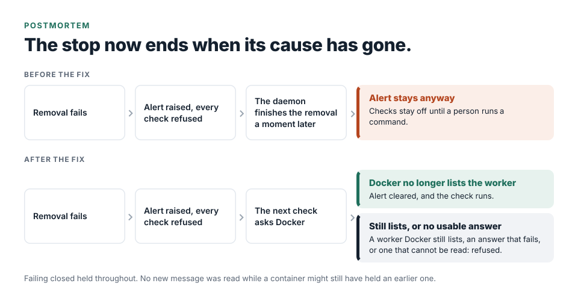

# Postmortem: a safety stop that needed a person to switch it off

This is a blameless account of a failure-handling gap in the part of Jatzo that reads hostile email. The safeguard
did its job. The recovery from it did not, and that is what I changed.

This was not a customer incident. The records I have show the behaviour in an evaluation run on my own machine, and
describe the wider case from an audit. I have not claimed it happened to a customer, because nothing I hold says it
did.

## Summary

Every message is read inside a disposable container that is removed when it finishes. If removal fails, Jatzo does
not know whether the container still holds the email it read. So it keeps an alert and refuses every new check,
in the website and in both add-ins, until the situation is resolved. That is the right way to fail.

The gap: when the container daemon was merely slow, and finished the removal a moment later, the alert stayed
anyway. Checks stayed off until a person signed in to the server and ran a command to clear it.

## Impact

- In the evaluation run on 12 September 2026, one worker failed to clean up. The alert was raised and further scans
  stopped, as designed. It was in that run's own data directory, not the live one. I cleared it with the operator
  command once Docker confirmed the worker was gone, and resumed the run.
- On a live installation the same state would have refused every check on all three surfaces until an operator
  acted. I have no record of how long that would have lasted, because I have no record of it happening live. The
  audit estimated that it could last for hours. That is its judgement, not a measurement.
- The incident record holds no email content: only the time, the event name and the container's generated name.
  The run itself was processing my own mail, so a worker that failed to clean up may have held one of those
  messages, which is why the stop is the right response.

## How it was found

In September I saw it because the evaluation run stopped scanning. The evaluation report filed the stop as the
safeguard working as designed, which it was, and I did not ask how the stop ended. The audit asked, on 11 October
2026, and rated the slow-daemon case Medium. The audit was an internal, static review of the code. Nobody outside
reviewed it, and it ran no tests.

On a live installation, the website's health check fails while an alert stands, so monitoring that watches it would
see the stop.

## Timeline

| Date | Event |
| --- | --- |
| 12 September 2026 | An evaluation run shows a worker failing to clean up, an alert, and scans stopped until a manual clear |
| 11 October 2026 | A whole-repository audit records the slow-daemon case: a removal finished late still left checks off |
| 16 October 2026 | The fix and its tests are committed |

I cannot show that the September event was the slow-daemon case. The records do not say. The October fix was written
against the case the audit described, and the September run is the occasion on which I saw the behaviour.

## What went wrong

Three things combined to cause it, and a fourth was found while fixing it.

1. **The alert was a latch.** It was set on the first failure and cleared only by a person, even when the condition
   that caused it had already gone.
2. **A moment in time was treated as a permanent fact.** "Removal failed" was true when it was observed, and
   stopped being true a moment later, but nothing looked again.
3. **A slow daemon looks like a failed one.** Removal is tried twice, each try with a short time limit, and the
   daemon is slowest when two workers are running at once. A removal can finish a moment after Jatzo has judged it to have failed.
4. **Found while fixing it: a test passed for the wrong reason.** The existing test for an alert that could not be
   written to disk passed only because nothing in it answered Docker's container listing. It would have passed
   whether or not the new behaviour worked.

## What went well

- Failing closed held. No new message was read while a container might still have held an earlier one.
- The incident file carried no customer data, so recording the failure created no new privacy problem.
- The operator command already existed, and it was safe: it clears an alert only when Docker no longer lists the
  container, and it removes nothing itself.

## The fix

The next check now makes the same test the operator command makes. It asks Docker which containers exist and clears
an alert only for a worker Docker no longer lists, because then the email went with it. Three cases stay refused:

- A worker Docker still lists.
- An answer that fails.
- An answer that cannot be read.

The listing is limited in time and in how often it is asked, so a run of refused checks does not each wait on a
slow daemon. A container that cannot be removed is still an outage, as before.

| Situation at the next check | Before | After |
| --- | --- | --- |
| Docker no longer lists the worker | Refused until a person clears it | Alert cleared, and the check runs |
| Docker still lists the worker | Refused | Refused |
| Docker's answer fails or cannot be read | Refused | Refused |

I chose to keep refusing when Docker cannot answer. The cost is a longer refusal during a daemon problem. The
alternative is clearing on a guess and letting new mail run while an old worker may still hold a message, and I
would take the longer refusal.

## Tests

- A worker Docker still lists keeps every check refused, and only the listing is asked for.
- An unreadable listing keeps the refusal.
- A removed worker is cleared and the check then runs.
- Three refused checks ask Docker once.
- The disk-failure test now has Docker list the worker, so it tests what it says.

## Action items

| Action | Status |
| --- | --- |
| Clear an alert at the next check when Docker no longer lists its worker | Done, 16 October 2026 |
| Keep the refusal when Docker still lists the worker or cannot answer | Done, 16 October 2026 |
| Limit how long and how often Docker is asked | Done, 16 October 2026 |
| Make the disk-failure test exercise what it names | Done, 16 October 2026 |
| Say in the operations notes that the check now clears a resolved alert itself | Done, 16 October 2026 |

## What I would take from this

- Decide how a safety stop ends when its cause has gone, and not only how it starts.
- Clear on evidence that the condition has gone, and keep the stop when the evidence is missing.
- When a test passes before and after a change, find out what it was actually exercising.

## Related

The worker this concerns is described in [the isolation post](03-isolating-hostile-email.md). The September run is
the later round in [the false-alarm post](01-cutting-false-alarms.md).

## Evidence

The engine and its records are private. Here is what each claim rests on.

| Claim | Source | What is shown here |
| --- | --- | --- |
| The September stop and its manual clear | My evaluation report for 12 September 2026 | Described |
| How a cleanup incident is recorded and cleared | The engine's operations notes | Described. The command and the directory names are left out |
| The slow-daemon case and its severity | The whole-repository audit, 11 October 2026 | This finding only |
| The fix, its time limits and its tests | The commit history, 16 October 2026 | Described |
