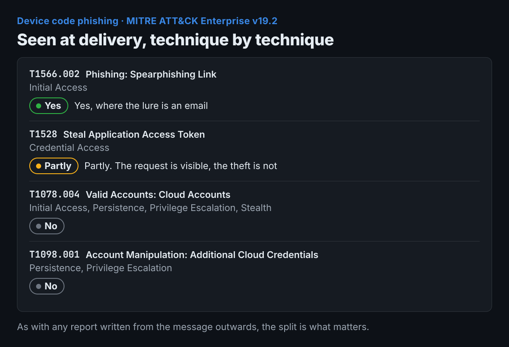

THREAT REPORT · TLP:CLEAR

# Device code phishing: the sign-in page is real

> Published on [jatzo.co.uk](https://jatzo.co.uk/research/device-code-phishing) on 29 September 2026. This copy was taken on 10 November 2026. The live page is the current version, and if the two ever differ, the live page is right. The charts are mine, drawn only from this page.

An account takeover where nothing is spoofed and the victim completes multi-factor authentication correctly, and what email analysis can and cannot see.

Published 29 September 2026. Every claim below carries its source.

## Bottom line up front

In device code phishing the sign-in page is genuine, the multi-factor prompt is genuine, and the victim completes both correctly. Nothing is spoofed and nothing is forged, so there is no lookalike domain to find and no fake form to block: the attacker simply receives the tokens that the victim's own real sign-in produced.

## What it is

The device code flow exists for equipment that cannot easily take a password: a television app, a screen in a meeting room, digital signage. The device shows a short code, the person types that code into a sign-in page on a phone or a laptop, and the device receives its tokens.

The attack is to run that flow on the attacker's behalf. They request a code from the real endpoint, send it to the victim with a story, and wait. The victim enters it at the real page, authenticates, satisfies MFA, and the attacker's waiting session collects the access and refresh tokens.

Microsoft's own guidance is blunt about the flow: [Conditional Access documentation](https://learn.microsoft.com/en-us/entra/identity/conditional-access/concept-authentication-flows) calls device code flow "a high-risk authentication method that can be part of a phishing attack" and says to block it wherever possible.

## How it works, step by step

- **The attacker asks for a code** from the legitimate authorisation endpoint. At this point nothing malicious exists anywhere, which is why there is nothing to scan.

- **Rapport comes first.** Both [Microsoft](https://www.microsoft.com/en-us/security/blog/2025/02/13/storm-2372-conducts-device-code-phishing-campaign) and [Volexity](https://www.volexity.com/blog/2025/02/13/multiple-russian-threat-actors-targeting-microsoft-device-code-authentication/) describe contact opening on a messaging platform, impersonating somebody the target would expect to hear from.

- **The lure arrives,** commonly framed as a meeting invitation (Microsoft).

- **The victim is sent to the real sign-in page** and types the code they were given.

- **They authenticate properly,** multi-factor included. This is the step that makes the technique work: the victim does everything correctly.

- **The attacker's session receives the tokens.** No password was ever handled by the attacker.

- **Persistence follows.** Microsoft records Storm-2372 moving to the Microsoft Authentication Broker client identifier, which yields a Primary Refresh Token and lets them register a device of their own. Volexity records app registrations being added to keep access.

Nothing in that sequence is forged. The flow is working exactly as designed, which is why [Microsoft](https://learn.microsoft.com/en-us/entra/identity/conditional-access/concept-authentication-flows) addresses it by removing the flow rather than by detecting an abuse of it.

## Who uses it

Only what the sources state.

- **Storm-2372**, which Microsoft assesses as Russia-aligned, with activity since August 2024 against government, non-governmental organisations, IT services, defence, telecommunications, health, education and energy across Europe, North America, Africa and the Middle East ([Microsoft, 13 February 2025](https://www.microsoft.com/en-us/security/blog/2025/02/13/storm-2372-conducts-device-code-phishing-campaign)).

- **Three clusters tracked by Volexity** from mid-January 2025, one assessed with medium confidence as CozyLarch, which overlaps with APT29 and Midnight Blizzard, and two tracked as UTA0304 and UTA0307. Their pretexts impersonated United States Department of State officials, Ukrainian Ministry of Defence representatives, European Parliament members and research staff ([Volexity, 13 February 2025](https://www.volexity.com/blog/2025/02/13/multiple-russian-threat-actors-targeting-microsoft-device-code-authentication/)).

## Indicators

**No network addresses appear in this report.** Every address involved in this technique belongs to Microsoft, which is the whole point of it, and publishing a list of legitimate sign-in endpoints as indicators would be worse than useless.

### In the email

- **A link to a genuine Microsoft device sign-in address, together with an instruction to enter a code.** The pairing is the signal. Neither half is suspicious alone, and the destination will pass any reputation check ever built, because it is real.

- Meeting invitation framing (Microsoft).

- No attachment, no lookalike domain, nothing misspelled.

### In the sign-in logs

Verified against the [Azure Monitor SigninLogs schema](https://learn.microsoft.com/en-us/azure/azure-monitor/reference/tables/signinlogs), which lists `deviceCode` among the possible values of `AuthenticationProtocol`.

- **`AuthenticationProtocol` set to `deviceCode`.** In the portal this is the **Device code** option under the

**Authentication Protocol** filter (Microsoft).

- **`OriginalTransferMethod` set to `deviceCodeFlow`** (Volexity). Microsoft's Conditional Access documentation describes the same property, shown in the portal as **Original transfer method** with the value **Device code flow**, and explains that it records a session which used the flow earlier.

- A device code sign-in from a country or address the user does not work from, followed by token use elsewhere.

### After the account is taken

- **New app registrations, or new credentials added to an existing one** (Volexity).

- **A device registration following a device code sign-in**, which is the Authentication Broker path Microsoft describes.

## ATT&CK mapping

MITRE ATT&CK Enterprise v19.2. As with any report written from the message outwards, the split is what matters.

| Technique | Tactic | Seen at delivery |
| --- | --- | --- |
| [T1566.002 Phishing: Spearphishing Link](https://attack.mitre.org/techniques/T1566/002/) | Initial Access | Yes, where the lure is an email |
| [T1528 Steal Application Access Token](https://attack.mitre.org/techniques/T1528/) | Credential Access | Partly. The request is visible, the theft is not |
| [T1078.004 Valid Accounts: Cloud Accounts](https://attack.mitre.org/techniques/T1078/004/) | Initial Access, Persistence, Privilege Escalation, Stealth | No |
| [T1098.001 Account Manipulation: Additional Cloud Credentials](https://attack.mitre.org/techniques/T1098/001/) | Persistence, Privilege Escalation | No |

## What Jatzo raises, and why

**Device sign-in code requested.** The strongest of the three, and the one built for exactly this. It needs a link in the message pointing at an identity provider's own device sign-in page _and_ text asking the reader to enter, use, type or input a code. The destination being genuine is what triggers it rather than what excuses it, which is the opposite of how a link reputation check behaves.

Which providers are recognised is the rule, so it is worth stating. Microsoft, Okta, Google and GitHub each publish the address their device flow sends a person to, and all four are read. The address is matched as whole path segments against hosts that belong to the provider, so a domain that merely ends in a provider's name is not mistaken for one of theirs, and an ordinary page on a genuine host is not mistaken for a device page.

**Account permissions requested.** The consent cousin of the same attack. It reads the authorisation link's own query string and fires when the scopes being requested include the ones that matter, such as offline access, mailbox read or write, or file access, alongside an instruction to allow, approve or grant.

**OAuth or device-code authorisation lure.** A broader net on language alone, for messages where no link survives forwarding or the instructions arrive without one.

The thing worth noticing: a link check asks whether the destination is bad, and here the honest answer is no. Jatzo asks a different question, which is whether anybody should be sending you a code to type into it.

## Mitigation

**For a small business.**

- **If nobody signs in on a screen without a keyboard, block the device code flow.** Microsoft recommends blocking it wherever possible, and most small organisations never use it.

- **A code you did not ask for is the attack.** Nobody legitimate sends you a sign-in code and asks you to enter it somewhere. Not IT, not a supplier, not Microsoft.

- Completing MFA does not mean the sign-in was yours.

**For a SOC.**

- **Conditional Access, authentication flows condition, device code flow blocked.** Run it in report-only first and look at what breaks.

- **Two caveats, both from Microsoft's own documentation.** Protocol tracking means a session that used the flow once stays tracked, so later sign-ins in that session can be blocked even when they did not use device code, and the error to expect is `AADSTS530036`. And a policy targeting all resources needs Device Registration Service excluded if your organisation registers devices through the flow.

- Hunt the two queries at the end of this report, and review who legitimately uses device code flow before turning anything to enforce.

- **Stronger MFA does not solve this one.** The victim completes the challenge correctly, so requiring a phishing-resistant method does not stop the token being issued to the attacker's session. Microsoft's own advice pairs phishing-resistant MFA with blocking the flow and Conditional Access, and the second half is what does the work here.

## Confidence

Using the [PHIA probability yardstick](https://www.gov.uk/government/publications/explaining-uncertainty-in-uk-intelligence-assessment/explaining-uncertainty-in-uk-intelligence-assessment).

- **It is highly likely that device code phishing continues while the flow stays available by default.** Two independent teams documented it on the same day, Microsoft assesses its own actor as state-aligned, and Microsoft advises blocking the flow, which is not advice given about a technique in decline.

- **It is almost certain that a device code lure passes destination reputation checks.** Every address in it belongs to Microsoft. This rests on the design of the flow rather than on any measurement.

- **It is a realistic possibility that an organisation has seen this and does not know**, because the evidence sits in a sign-in log filter that nobody looks at unless they have been told to.

## Limits

**Jatzo sees the email and never the sign-in.** The token issue happens inside the identity provider, minutes later, and no email analyser is present for it.

**Where the code arrives on a messaging platform, there is no email at all.** Both sources describe contact opening on Signal, WhatsApp or Teams. If the code never travels by mail, nothing in this product sees any part of the attack.

**Jatzo cannot tell an expected device code from an unexpected one.** A person signing a meeting room screen into their tenant gets the same message shape as a victim. Only the recipient knows whether they started it, which is why the finding says to complete only a flow you began yourself.

**Two providers running the same flow are not recognised.** Auth0 and Amazon's identity centre both implement the device authorisation grant, and neither publishes a literal verification address in its documentation, so there is nothing to match without inventing it. A lure pointing at either would not raise this finding, and guessing an address would leave the rule looking present while catching nothing.

## Hunting queries

Written for Microsoft Defender advanced hunting, where these table and column names come from. They are examples to adapt rather than finished detections: an estate streaming different data calls the same things by different names, and both of these return legitimate results by design.

### Every sign-in that used the device code flow

The flow records itself. Most tenants use it for nothing, so on many estates any result at all is worth reading, and on the rest the question is which accounts and which addresses.

 `SigninLogs | where AuthenticationProtocol == "deviceCode" | project TimeGenerated, UserPrincipalName, AppDisplayName, AppId, IPAddress, Location, ResultType | order by TimeGenerated desc`

Establish who uses the flow legitimately before blocking it. A meeting room screen and a victim produce the same row, and the difference is whose account it is.

### Sessions still carrying a device code origin

A session that used the flow once stays marked, so later activity from the same session can be found even when that request did not use device code itself.

 `SigninLogs | where OriginalTransferMethod == "deviceCodeFlow" | where AuthenticationProtocol != "deviceCode" | project TimeGenerated, UserPrincipalName, AppDisplayName, IPAddress, Location, ResultType | order by TimeGenerated desc`

The same marking is why a Conditional Access block on the flow can refuse a later sign-in that did not use it. Expect that rather than treating it as a fault.

## Sources

Published research only. Nothing in this report came from a sample, a corpus or an indicator feed, and no address named in any of it was visited.

- [Storm-2372 conducts device code phishing campaign](https://www.microsoft.com/en-us/security/blog/2025/02/13/storm-2372-conducts-device-code-phishing-campaign). Microsoft Threat Intelligence, 13 February 2025.

- [Multiple Russian threat actors targeting Microsoft device code authentication](https://www.volexity.com/blog/2025/02/13/multiple-russian-threat-actors-targeting-microsoft-device-code-authentication/). Volexity, 13 February 2025.

- [Authentication flows as a condition in Conditional Access policy](https://learn.microsoft.com/en-us/entra/identity/conditional-access/concept-authentication-flows). Microsoft Learn, 25 March 2026.

- [Azure Monitor Logs reference: the SigninLogs table](https://learn.microsoft.com/en-us/azure/azure-monitor/reference/tables/signinlogs). Microsoft Learn, 28 August 2026.

- [ATT&CK Enterprise v19.2, the techniques cited below](https://attack.mitre.org/). MITRE, 6 August 2026.

Confidence language follows the [PHIA probability yardstick](https://www.gov.uk/government/publications/explaining-uncertainty-in-uk-intelligence-assessment/explaining-uncertainty-in-uk-intelligence-assessment).

## Who produced this

Jatzo is a cyber security company in the North East. We make an email threat analyser, which is why these reports are written from the message outwards and say plainly where that view ends.
